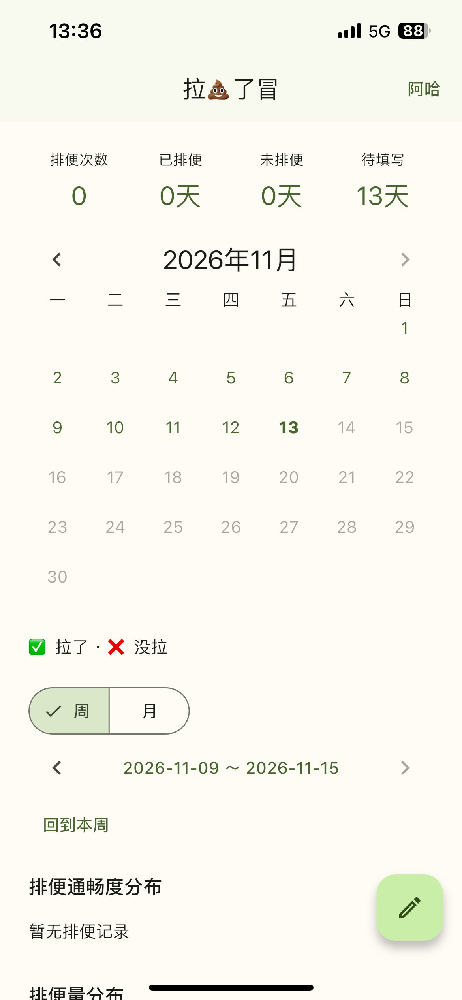
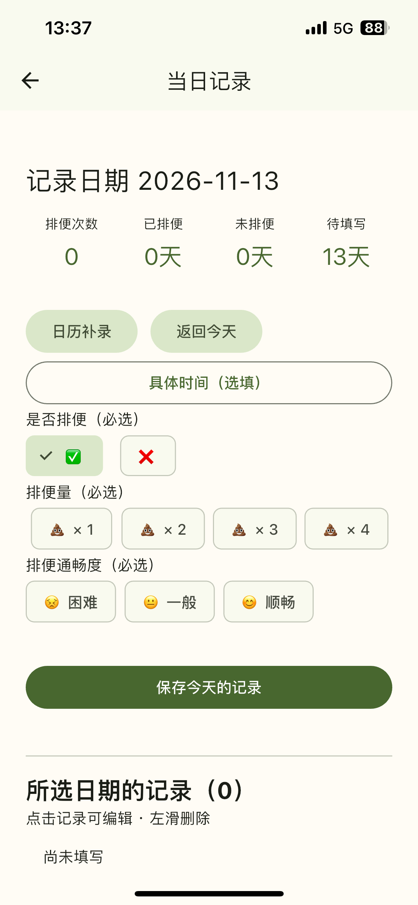
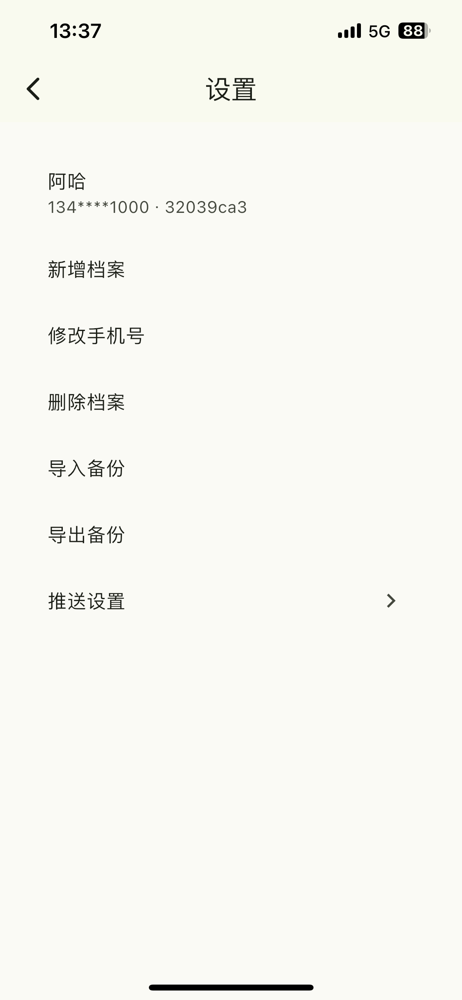

# 拉💩了冒

## 为什么会有这个 App

家里有小盆友，拉臭臭有时候不太规律，之前一直用记事软件做记录。突然有一天，老婆说：“你为何不自己做一个？我看小红书上也有很多人做记录，但是没找到相关应用。”

一句话的需求落到实处，就有了这个 App。

我有 iOS 开发经验，再加上 AI 的帮助，就动手做了起来。

## 这个 App 干什么

首先，它是一个**离线应用**。我很在意这一点，排便记录属于个人隐私，保存在本地就好。

它记录的事情很简单，**今天你拉了吗？拉得舒服吗？拉得多吗？**还可以通过日历查看历史记录，为家人分别建立档案。

它也支持数据导入与导出，方便备份和换手机时迁移数据。

你或许会疑惑，为什么建立档案时要输入手机号？它只是用来区分本地用户档案，应用无需联网，也无需短信验证。

  
  
  

## 我的思考

这个 App 的代码都是 AI 写的，图标也是 AI 帮忙画的。我主要负责产品交互指导和最后验收，以及写这份 README。

开发过程中使用了 [Skills For Real Engineers](https://github.com/mattpocock/skills/tree/49dd158d1076134a641b33efb035946536778336) 中的 AI 工作流，这里就不展开技术细节了。

这种从 0 到 1 的小项目，很适合借助 AI 完成。不过，面对庞大复杂的系统，仍然需要保持敬畏。在这个项目里，代码几乎都交给了 AI，我更多地关注需求、交互，以及最终用起来怎么样。

AI 让实现想法变得更容易，也让我觉得，抓住灵光一现的想法，动手把它做出来，很重要。

## 遇到的问题

目前比较头疼的是 Android 端的本地提醒。有时不准时，甚至完全没有提醒，即使开启了相关权限、允许后台运行，也未必能解决。

相比之下，在我自己的 iPhone 上，提醒一直准时。这方面 iOS 确实省心，~~就是就业不省心~~。

## 备注

“拉💩了冒”是一句武汉话，“冒”是“没”的意思，连起来就是“拉屎了没”。

这个项目使用 Flutter 编写，已经在我自己的 iPhone 和 Android 手机上跑通。考虑到开发者账号、ICP备案、发布流程等个人条件，目前没有上架计划。

这是一个自家用的 App。如果你也想用，可以下载安装。有想法或需求，欢迎提出，我会在空闲时考虑是否加入。

## 下载地址

Android 用户可以在 [Releases 页面](https://github.com/seasonZhu/PoopToday/releases)下载安装包。

## 许可证

本项目源码采用 [PolyForm Noncommercial License 1.0.0](LICENSE.md)，许可证标识为 `PolyForm-Noncommercial-1.0.0`。允许的使用、修改及再分发范围以许可证全文为准，商业使用需另行取得授权。第三方依赖及资源遵循各自的许可证。
